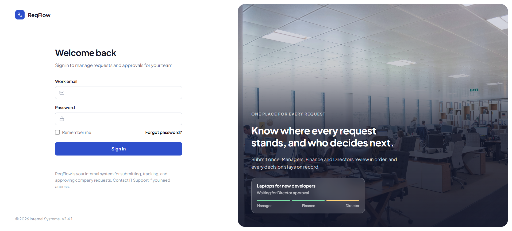
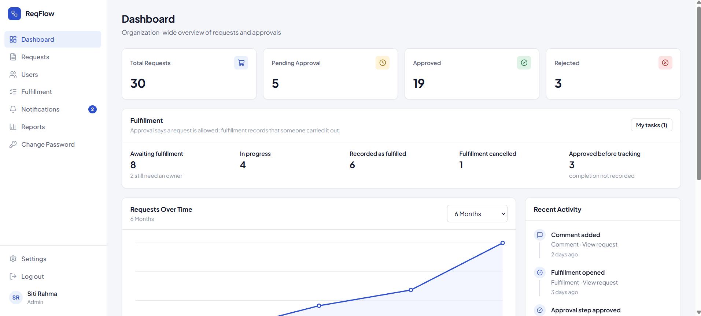
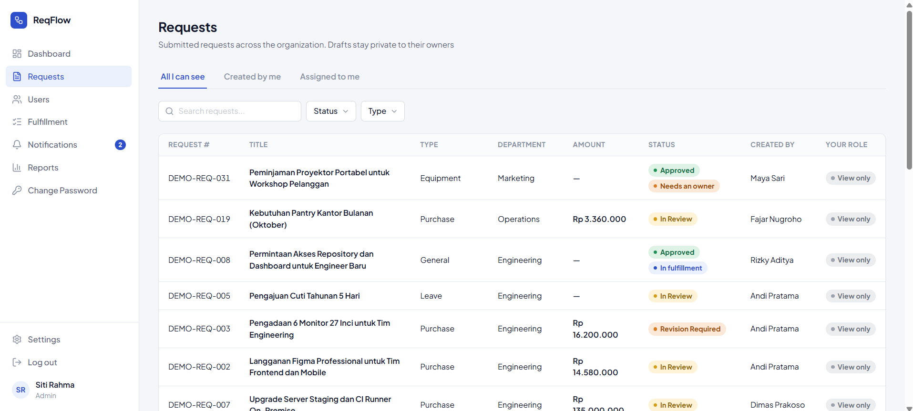
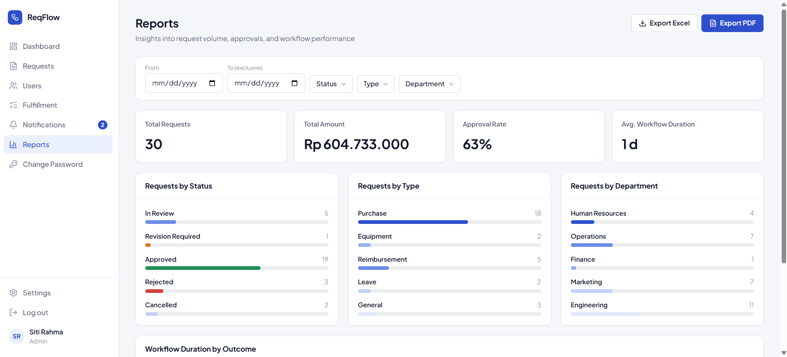
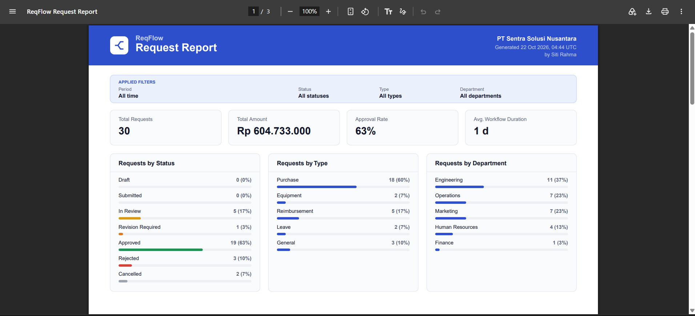
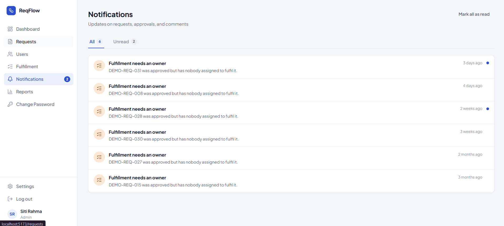
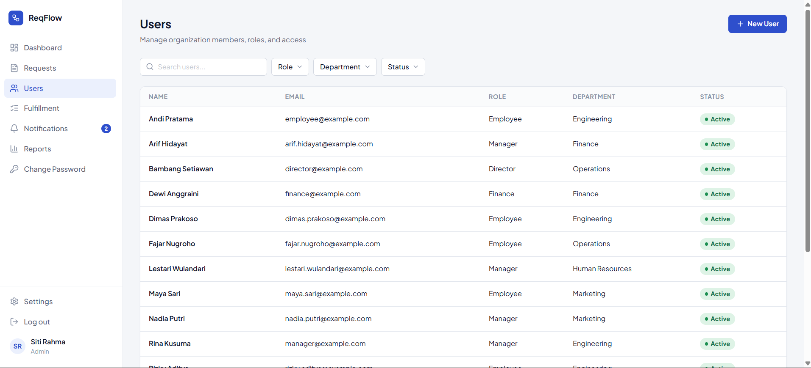

<div align="center">


# ReqFlow

**Internal Request & Approval Management System**

Submit a request, route it through the right approvers, track it to completion.


</div>

ReqFlow is a web-based system for managing internal organizational requests through structured approval workflows. Employees submit purchases, reimbursements, leave, and other requests; each one moves through a policy-based chain of Manager, Finance, and Director approvals, and approved work is tracked through fulfillment. It also provides request tracking, role-based dashboards, and reporting.

This repository is the **frontend**. It is a full-stack portfolio project: the REST API lives in a separate repository, `reqFlow-backend`.

## 📸 Screenshots

<p align="center">
  
</p>

| Dashboard | Requests |
| --- | --- |
|  |  |

| Reports | Exported PDF |
| --- | --- |
|  |  |

| Notifications | User Management |
| --- | --- |
|  |  |

## ✨ Key Features

- 📝 **Requests**: create, edit, submit, withdraw, and track requests with a rich-text description; search and filter by status and type.
- ✅ **Multi-level approvals**: Manager, Finance, and Director steps depending on request type and amount, with an approval inbox, review page, and per-step history.
- 🔐 **Role-based access**: Employee, Manager, Finance, Director, and Admin each see a navigation, dashboard, and request scope that fits their role. Actions are only enabled for the assigned approver; the backend is the authority.
- 📦 **Fulfillment tracking**: approved requests continue into a fulfillment task list, so "approved" and "done" are tracked separately.
- 📊 **Dashboard & reports**: role-specific dashboards, plus filterable reports with Excel and PDF export.
- 🔔 **Notifications & activity**: in-app notifications with unread counts, and an activity history on each request that includes reassignments and withdrawals.
- 💬 **Comments & attachments** on requests.
- 👥 **User management** (Admin): create users, change role and department, activate or deactivate accounts, and reassign a stuck approval step.

## 🧰 Tech Stack

| Area | Technologies |
| --- | --- |
| Framework & language | React 19, TypeScript (strict), Vite |
| Routing & server state | React Router 7, TanStack Query 5 |
| Forms & validation | React Hook Form, Zod |
| Styling & UI | Tailwind CSS 4, custom design-system CSS, Radix Slot, Lucide icons, Tiptap (rich text) |
| API integration | Fetch-based client with cookie sessions (`credentials: 'include'`) against `reqFlow-backend` |
| Testing & tooling | Vitest, React Testing Library, jsdom, ESLint, Prettier |

## 🚀 Getting Started

**Prerequisites**

- Node.js 22.22.2+ (or 24.15+, or 26+) and npm
- A running `reqFlow-backend` instance (the app has no data without it; see that repository for its setup)

**Install and run**

```bash
npm ci
cp .env.example .env.local   # PowerShell: Copy-Item .env.example .env.local
npm run dev
```

Set `VITE_API_BASE_URL` in `.env.local` to the backend URL (the example uses `http://localhost:3000`). It must be an absolute HTTP(S) URL. All `VITE_*` values are public in the browser bundle, so never put secrets there.

Sessions use cookies, so the backend's CORS origin must match the frontend origin. Vite's default is `http://localhost:5173`.

**Scripts**

| Command | Purpose |
| --- | --- |
| `npm run dev` | Start the development server |
| `npm run build` | Typecheck and build for production |
| `npm run preview` | Preview the production build |
| `npm run lint` | Run ESLint |
| `npm run typecheck` | Run the strict TypeScript check |
| `npm run test:run` | Run unit and component tests once (`npm test` for watch mode) |

## 🗂️ Project Structure

```text
src/
  app/          providers, layout shell, router
  components/   shared components and UI primitives
  features/     auth, requests, approvals, fulfillment, collaboration,
                dashboard, notifications, reports, users
  lib/          API client, env validation, navigation
  styles/       design-system CSS
  test/         test setup, helpers, fixtures
public/         static assets (favicon, README screenshots)
```

Each feature module owns its API functions, hooks, Zod schemas, and components.

## 🎯 Project Context

ReqFlow demonstrates frontend development for a real-world organizational workflow: complex application states (draft, in review, approved, fulfilled), role-based interfaces, typed API integration, URL-driven filtering, and responsive layouts. It is a portfolio project, not a deployed product.
